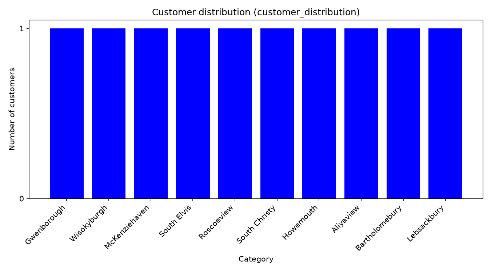
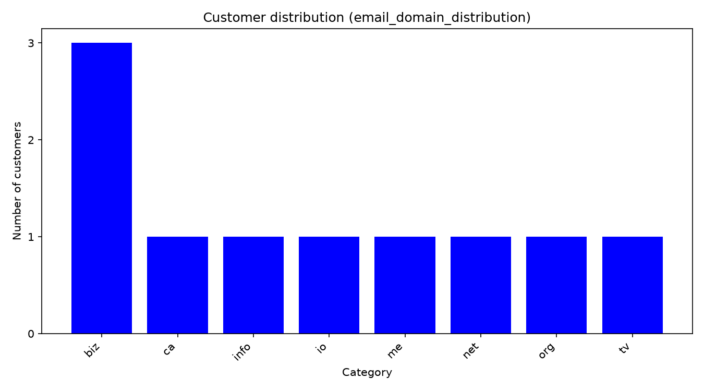

# API Data Analysis Using Python


## 1. Project Overview

Pesa Pulse is a fictional Nairobi fintech start-up that wants to understand its customer directory before planning regional marketing campaigns.

This project retrieves sample user data from the JSONPlaceholder API, explores its nested JSON structure, extracts relevant customer attributes, analyses geographical and email-domain distributions, and visualises the results.

**Note:** JSONPlaceholder provides mock user data. These records do not represent actual Pesa Pulse customers.

## 2. Project Objectives

- Retrieve JSON data from an API using Python Requests.
- Handle unsuccessful requests and network failures.
- Explore nested dictionaries and lists.
- Extract and flatten customer attributes.
- Identify unique cities using sets.
- Count customers using dictionaries and comprehensions.
- Analyse data using pandas.
- Export results to CSV files.
- Create charts using Matplotlib.

## 3. Tools and Libraries

- Python
- Requests
- pandas
- Matplotlib
- Git and GitHub

## 4. Project Structure

```text
day1-api-analysis/
├── analysis.py
├── requirements.txt
├── README.md
└── output/
    ├── customers.csv
    ├── city_counts.csv
    ├── customer_distribution.png
    └── email_domain_distribution.png
```

## 5. Data Source

The project uses the JSONPlaceholder Users API:

https://jsonplaceholder.typicode.com/users

The API returns sample user records containing personal details, addresses, geographical coordinates, and company information.

## 6. Methodology

### Step 1: API data retrieval

The `get_customers()` function sends a GET request with a timeout, checks the HTTP response status, and parses the returned JSON.

### Step 2: Explore nested data

The `explore()` function prints dictionary keys and their Python data types. Nested attributes include:

- `address`, which contains the city, zipcode, and geographical information.
- `address.geo`, which contains latitude and longitude.
- `company`, which contains company details.

Latitude is accessed using `customer["address"]["geo"]["lat"]`, while longitude is accessed using `customer["address"]["geo"]["lng"]`.

### Step 3: Extract attributes

The `extract_attributes()` function converts the nested records into flat dictionaries containing 12 columns:

`customer_id`, `name`, `username`, `email`, `email_domain`, `phone`, `city`, `zipcode`, `latitude`, `longitude`, `company`, and `website`.

Latitude and longitude are converted to floating-point numbers.

### Step 4: Analyse unique cities and customer counts

A set identifies unique cities. A dictionary and loop count customers by city, while a dictionary comprehension is used to aggregate email top-level domains.

### Step 5: Validate with pandas

The extracted records are converted into a DataFrame. The `value_counts()` method checks the frequency counts against the plain Python results.

### Step 6: Export and visualise

The project exports customer records and city counts to CSV without the pandas index. Matplotlib generates a customer distribution chart and an additional email-domain-extension chart.

## 7. Key Findings

Based on the standard API sample:

1. **Customer records:** The API supplies 10 sample users.
2. **Geographical distribution:** The sample contains 10 unique cities, with one user per city. There are no repeated cities in this dataset.
3. **Email extensions:** The sample contains multiple email top-level domains. The `biz`, `info`, `net`, and `com` extensions each appear twice, while `org` and `io` each appear once.

These findings describe the mock dataset only and should not be generalised to actual Pesa Pulse customers.

## 8. Visualisation

The city distribution chart illustrates the number of records per city. However, because every city has one record, it does not identify a leading geographical market.

The email extension chart is more useful for comparing repeated categories in this sample. Email extensions are not indicators of customer location, purchasing behaviour, or marketing preferences.

## 9. How to Run the Project

### Prerequisites

Install Python and ensure that it is available from your terminal.

### Installation

Open a terminal in the project folder and run:

```bash
python -m pip install -r requirements.txt
```

### Execution

Run the analysis:

```bash
python analysis.py
```

An active internet connection is required to retrieve the API data.

### Expected outputs

The script generates the following files in the `output/` directory:

- `customers.csv`
- `city_counts.csv`
- `customer_distribution.png`
- `email_domain_distribution.png`

## 10. Assumptions and Limitations

- Each API record represents one sample customer.
- The API data is mock data rather than actual business data.
- Email extensions are used for descriptive analysis only.
- Results depend on the records returned by the API.




